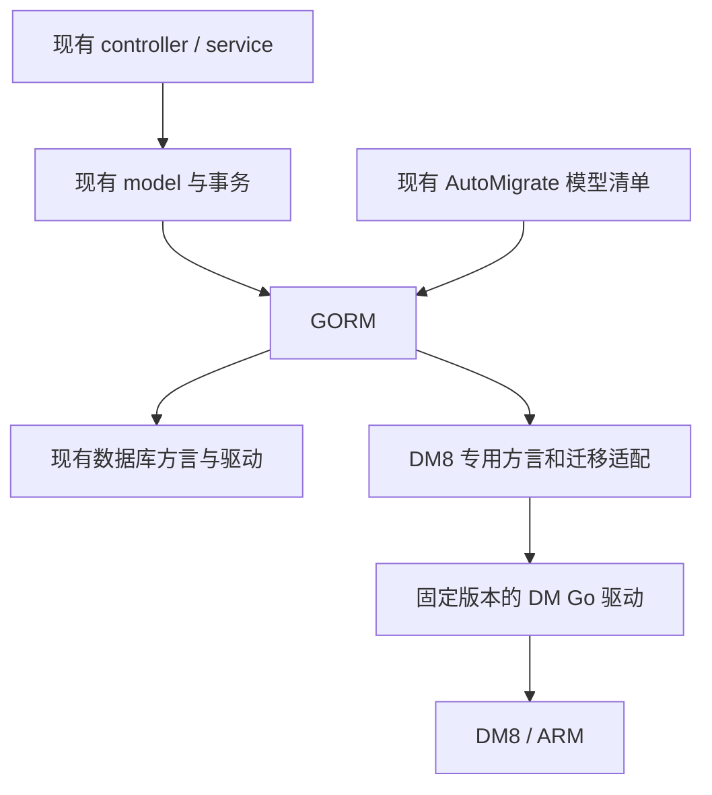

# new-api 接入 DM8：以降低上游合并成本为目标的设计

日期：2026-09-21

代码基线：`6e9de44a7dca08f44234ab9c623f6a93a174d0c4`

状态：待用户评审；完成代码与候选驱动源码检查，尚未实施或通过数据库验证

流程记录：

- [x] 核对现有架构和用户约束
- [x] 比较方案并形成书面设计
- [x] 完成设计自检，明确环境与驱动验证前置条件
- [ ] 用户评审并批准本设计
- [ ] 使用 writing-plans 生成 docs/superpowers/plans/ 下的实施计划
- [ ] 用户评审实施计划并选择执行方式
- [ ] 按计划实施并验证

## 1. 目标与已知环境

用户的首要目标是在尽量少修改开源上游代码的前提下接入 DM8，并方便后续合并新功能。因此选择“DM8 专用适配文件 + 必要入口分支”，保留现有 GORM、模型定义、全局 DB/LOG_DB、业务调用链和迁移清单。

已确认目标为 DM8、ARM 架构。完整数据库构建号、服务器操作系统、ARM 位数、兼容模式、大小写设置和测试实例可用性尚未提供。构建示例暂以 Linux ARM64 为候选部署配置；这不是对现有环境的确认。

首期支持范围：

- 主库使用 DM8；日志与主库共用时也必须可用。
- 通过现有 LOG_SQL_DSN 独立选择 DM8 日志库，或继续使用已有日志数据库。
- 相同程序通过连接配置选择数据库，切换在重启后生效。
- 新建 DM8 数据库，以及已经采用本适配约定的 DM8 数据库后续升级。
- 保持 SQLite、MySQL、PostgreSQL 的现有行为，保持 ClickHouse 仅用于独立日志库的限制。

跨数据库历史数据搬迁、零停机切换、双写、自动回切不属于本次适配。导入已有数据后仍需验证约束、自增值和业务一致性，不能只换连接串。

## 2. 方案选择

| 方案 | 对上游的影响 | 结论 |
| --- | --- | --- |
| 在各业务文件直接补全 DM 分支 | 起步简单，后续专用逻辑分散 | 仅用于无法在驱动边界处理的少数位置 |
| DM 专用 GORM 适配器，辅以少量业务入口修改 | 大部分逻辑位于新增文件，保留上游结构 | 推荐 |
| 重建统一 database/repository 层 | 移动文件、调整接口和调用链，merge 冲突面扩大 | 本次不采用 |

最小改动以“尽量少触碰上游的职责和调用关系”为标准，不预先承诺只修改三五个文件。绕过唯一约束、忽略迁移失败或隐藏 SQL 改写，都会降低后续同步的可靠性。

## 3. 结构与责任



建议新增文件均留在现有 model 包中，避免新建一个上层必须迁移过去的数据访问体系：

| 新增文件 | 职责 |
| --- | --- |
| model/dm8.go | 打开 DM 连接、校验部署配置、DM 错误识别 |
| model/dm8_dialector.go | 类型和标识符映射；只有 DM 连接使用的 GORM 扩展 |
| model/dm8_migrator.go | 元数据读取、索引、约束、迁移差异及 DM 专用锁表 |
| model/dm8_compat.go | 时间表达式、邮箱串行化等已证实需要的专用行为 |
| model/dm8_integration_test.go | 集中的真实 DM 回归用例与夹具 |

文件只在确有对应职责时新增；若冲突写入适配较复杂，可独立为 dm8_create.go。优先扩展既有合适测试，不在各层重复建立同一组测试。

## 4. 驱动与依赖决策

当前项目使用 Go 1.25.1、GORM v1.25.12、MySQL 方言 v1.5.7、PostgreSQL 方言 v1.5.9。首选保留这组版本，新增 DM 驱动；不以接入 DM 为理由同时升级 ORM。

生产驱动先评估与目标 DM8 安装版本匹配的官方 Go/GORM V2 包，确认依赖、来源、许可、可重现获取方式及 ARM 构建条件。社区 godoes/gorm-dameng v0.6.0 可作为兼容当前 GORM 的对照候选，不直接视为可上线版本。

源码调查结果：

- 社区 v0.6.0 的 go.mod 要求 GORM v1.25.12；v0.7.2 要求 v1.30.1；本次查询到的 main 要求 v1.31.2。直接使用 latest 会扩大依赖变更。
- v0.6.0 的 Create 路径在没有提供全部主键值时不进入冲突处理，其 MergeCreate 按主键构造匹配条件。项目存在按 token_hash 等非主键唯一列执行 OnConflict 的实际调用。
- 该版本的合并写入路径还存在以全表 ID 倒序查询取回主键的实现；不能把这种结果当作并发场景下可靠的本次插入 ID。
- 该版本 GetIndexes 源码把 NON_UNIQUE 结果赋给 UniqueValue，索引元数据布尔含义必须核实、纠正后才能供迁移使用。

以上是源码风险判断，不是已在 DM 实例上复现的结论。官方包同样必须验证，不能因为来自官方就跳过项目契约检查。

驱动验证必须先于大范围修改。产出固定包版本或校验和、依赖树、目标平台构建结果和关键数据库契约结果；未通过则调整 DM 适配器或候选驱动。若必须升级 GORM，重新评估整组现有方言兼容性及改动范围，不使用强制 replace 降级伪装兼容。

## 5. 接入方式与配置示例

chooseDB() 在现有 MySQL 兜底之前增加 dm:// 分支，由 DM 专用函数返回连接；不改变其他连接串的识别顺序和语义。增加 DatabaseTypeDM，其方言名称统一为 dm。

改造后配置示例，当前代码尚不可直接使用：

```dotenv
# 主库与日志共用 DM；密码中的特殊字符需按连接串规则编码
SQL_DSN=dm://app_user:example_password@dm-host:5236?schema=APP_SCHEMA
# LOG_SQL_DSN 不设置
```

```dotenv
# 分离主库与日志 schema；也可将 LOG_SQL_DSN 配为现有 PostgreSQL/MySQL 等
SQL_DSN=dm://app_user:example_password@dm-host:5236?schema=APP_SCHEMA
LOG_SQL_DSN=dm://log_user:example_password@dm-host:5236?schema=APP_LOG_SCHEMA
```

继续使用 SQL_MAX_IDLE_CONNS、SQL_MAX_OPEN_CONNS、SQL_MAX_LIFETIME。DM 初始配置不启用 GORM 显式 PrepareStmt 缓存，先保证正确性；驱动内部是否缓存语句单独记录。复用现有日志器，补充 DM 服务端错误脱敏，日志不输出完整 DSN、认证凭证或包含秘密参数的驱动错误。

启动时检查连接、当前 schema、支持的服务器配置及必要权限。不自动变更实例参数。DM 连接失败必须报错，不能降级连接 SQLite/MySQL。DM 仅作为日志库时不运行主库业务迁移。

## 6. 标识符、字段与查询策略

### 6.1 标识符与大小写

推荐初始验证配置使用 UTF-8、大小写敏感（CASE_SENSITIVE=1）的实例，优先评估 MySQL 兼容模式（COMPATIBLE_MODE=4）以减少现有语法差异。兼容模式是部署约定，不意味着将 DM 当成 MySQL 驱动。实际支持配置以目标实例验证结果锁定。

不能为少改字段引用而直接要求关闭大小写敏感：达梦官方说明该配置同时影响对象名和表中数据；API key、外部身份标识等比较必须保持精确语义。

建议 DM 物理标识符统一大写，以适配现有大量未加引号的小写 SQL 标识符。Go 字段名、JSON 名称和其他数据库的表结构不变。转换只发生在 DM 的结构化标识符、迁移元数据和结果字段映射边界：

- DM QuoteTo 与 Migrator 对表、列、索引使用同一命名规则；显式 column 标签也必须覆盖。
- 元数据查询参数和返回的 ColumnTypes/GetIndexes 名称与该规则一致。
- 结果列名和别名必须能够正确映射到现有 Go 字段，包含 Scan 到结构体和 map 的场景。
- main.go 中的 group/key 引用、业务中已有带引号的字段片段，按 DM 规则补充分支。
- 不对整段 SQL 做 ToUpper、反引号全局替换或正则重写，不改变参数、字符串字面值及用户提供的数据。

这项方案必须在驱动验证阶段同时通过 CRUD、联表别名、显式 column 标签及重复迁移测试，不能只验证 QuoteTo。若候选驱动无法通过稳定扩展接口满足要求，评估其他驱动或明确的小范围查询修正；不直接扩展为自制 SQL 解析器。仅支持本适配器建库约定，任意已有混合大小写 schema 需另行迁移。

### 6.2 类型和数据值

- 保持 Go 模型定义，优先在 DM 方言中将 JSON/大文本映射为经验证可读写的文本大字段；不依赖所有 DM8 版本都有原生 JSON 类型。
- 校验 CLOB 返回值与现有 Scanner/Valuer 的兼容性，包括 nil、空串、中文、emoji 和大字段；不能静默读成空值或截断。
- 无长度的 string 不能简单全部落入候选驱动默认的有限长度 VARCHAR。按是否参与索引及实际用途设置 DM 映射，并验证 channels.key/models 等可增长字段。
- 布尔字段和字面值单独处理，不能把“使用双引号”的选择与 PostgreSQL true/false 字面量绑定。
- 保持 bigint、decimal 的精度和零值。ensureUserQuotaColumns/is64BitIntegerType 增加经实际元数据验证的 DM 分支，不关闭钱包位宽检查。
- 包装 Migrator 时确保其内部实际使用包装后的 Dialector，避免只覆盖外层 DataTypeOf 而建表仍调用原驱动。

### 6.3 业务查询

现有普通 GORM 查询继续复用。已定位的检查点包括 channel 的字段引用及字符串拼接，topup/subscription/redemption 的字段引用，db_time 的时间函数，usedata_rankings 的除法取整，日志的 LIKE 转义、聚合、分页与删除，以及 ability 的 TRUNCATE 行为。

只修正真实不兼容位置；保留原有分支，对 DM 新增短分支。主库与日志库分别依据对应连接/类型选择行为。DM 的数据库时间函数需有明确实现，不能靠当前错误后回退应用时间来掩盖缺失适配。

## 7. 冲突写入、事务与安全契约

OnConflict 适配只安装在 DM 的 GORM 实例上，其他连接不注册该回调。覆盖当前所有实际用法：无显式冲突列的 DoNothing、指定唯一列的 DoNothing、复合键、DoUpdates、表达式更新和批量写入。保留钩子、事务、取消和错误传播。

唯一约束作为并发最终保障。不能用未加锁的“先查后写”模拟原子冲突处理；指定目标约束时不能吞掉其他约束错误。不支持的子句明确报错，不静默忽略。新插入、冲突忽略、条件更新的 RowsAffected 必须满足现有调用方契约，插入 ID 必须属于当前操作，不能读取全表最大 ID。

实际影响包括认证断言的单次消费（auth_flow.go）、外部身份归属（external_identity_claim.go）、能力记录批量写入及任务状态更新。数据库适配完成前必须验证这些行为。

lockForUpdate() 对 DM 保持数据库行锁；验证独立连接上的互斥、回滚和释放行为。邮箱锁需要额外 DM 分支：当前代码只为 PostgreSQL/MySQL 显式串行化，不能让 DM 默认为“无需锁”。

首期建议在 DM 专用锁表中预置一条邮箱写入互斥记录，在现有事务内先锁该行，再执行原邮箱检查和写入；锁随事务结束释放。所有邮箱写入共享该锁，降低实现复杂度，代价是邮箱写入串行。锁表和记录在迁移时创建，缺失即失败；不能对不存在的邮箱记录执行 FOR UPDATE 并假定已锁住未来插入，也不能用进程内锁代替跨实例锁。实施时核对所有入口和既有锁顺序，防止死锁。

计费保持现有预扣、结算、退款计算及幂等语义；DM 适配不调整价格或额度算法。涉及认证持久化的适配依据 OWASP ASVS 5.0.0 和认证、会话管理指南，重点保留参数化查询、断言单次消费、会话撤销/过期、身份唯一归属与敏感日志脱敏。适用条目记录为 v5.0.0-1.2.4、7.4.1、7.4.2、7.4.3、16.2.5、16.5.1；本设计不构成合规验证结论。

## 8. 迁移与上游新增模型

继续执行现有 migrateDB()/migrateLOGDB() 和唯一一份 AutoMigrate 模型清单。DM 特例通过 Migrator 或少量前后置调用补充，不复制全套建表 SQL，不维护一份单独的 DM 全量模型列表。

- 主库和共库日志、独立日志的建表流程全部覆盖。
- 正确识别主键、唯一索引、普通索引、nullable 和默认值；不能把查询元数据失败当作对象不存在。
- 重点验证 options.key、tokens.key、认证相关唯一约束，以及 prefill_groups 的软删除条件唯一性。DM 若不支持原有索引语法，由 DM Migrator 提供并验证等价约束；不能简单删掉 where 条件或唯一属性。
- DM 迁移失败须阻止对外服务。现有 options 主键迁移只记录错误的路径，在 DM 接入处增加明确的前置/后置约束校验，避免错误被吞掉后继续运行。
- 不假设 DDL 可事务回滚。修复旧表采用可恢复步骤，保留源表/备份，验证后切换；异常中断后能够识别状态并恢复，失败不自动删原数据。
- 初期按现有单迁移主节点部署，其他节点在迁移完成后启动；不承诺多节点同时自动升级。

DM 首次适配不存在“最新上游版本原生创建的 DM 库”。原有三库的升级夹具必须由最新发布版创建；DM 则分别验证本适配约定的前一 schema 夹具，以及从发布版代表性数据库导入后的数据和约束。后者用于验证导入后的应用兼容性，不代表提供了自动跨库迁移工具。

## 9. 预计修改面

| 现有文件 | 修改性质 |
| --- | --- |
| go.mod / go.sum | 固定 DM 依赖及必要传递依赖 |
| common/database.go | 增加 DM 类型 |
| model/main.go | DM 连接入口、字段/布尔引用、钱包类型识别、必要迁移钩子 |
| model/gorm_logger.go | DM 错误脱敏入口 |
| model/db_time.go | DM 时间分支 |
| model/user.go | DM 邮箱锁分支 |
| model/channel.go、topup.go、subscription.go、redemption.go | 已有显式引用片段的 DM 兼容分支 |
| model/usedata_rankings.go | 根据验证结果补充 DM 分桶表达式 |
| 既有相关测试、.env.example | 回归与连接示例 |

其余修改由真实失败用例证明必要性。controller、service、relaykit、前端和现有工作流不做架构性调整。独立 DM 验证脚本/工作流需要时新增，避免大改上游 CI。

## 10. 验收矩阵

| 验证组 | 必须证明的结果 |
| --- | --- |
| 目标 ARM 环境 | 目标 OS/位数确认；保持现有 CGO_ENABLED=0 路线可构建；目标机器实际运行并访问真实 DM8 |
| 原有三库 | 真实 SQLite、受支持 MySQL、PostgreSQL 通过受影响行为测试，记录精确版本 |
| 启动与升级 | 新库、最新发布版代表性旧库升级；连续迁移两次；第二次不反复改列/重建索引 |
| 数据映射 | 自增主键、显式 ID 导入后继续插入、NULL/空串/false/0、中文/emoji、JSON/CLOB、decimal/bigint |
| 查询 | 搜索、过滤、联表、别名、分页、排序、聚合、日志时间范围及分桶 |
| 并发与业务 | 独立事务锁、邮箱竞争、任务抢占、冲突忽略与更新、充值回调幂等、额度扣减及回滚 |
| 认证 | 断言重放与过期、会话撤销、外部身份冲突、大小写不同的凭证、日志不泄露凭证 |
| 日志组合 | DM/共库、DM/独立 DM、DM/已有日志库，以及已有主库/DM 日志；已有 ClickHouse 路径回归 |

沿用已有 TEST_MYSQL_DSN、TEST_POSTGRES_DSN，增加 TEST_DM_DSN。测试只操作隔离的测试数据库/schema，显式恢复全局 DB 和类型状态，相关用例不并行污染全局变量。使用 testify 的 require/assert；并发测试采用确定性同步，不靠 sleep 或随机循环证明正确性。

发布验证必须检查矩阵用例实际运行，缺 DSN 导致 Skip 不能计为通过。单元测试、DryRun 和交叉编译均不能替代真实数据库或 ARM 运行验证。

规划中的构建检查示例（本次尚未执行）：

```sh
GOWORK=off go vet ./...
GOWORK=off go build ./...
make test
CGO_ENABLED=0 GOOS=linux GOARCH=arm64 GOWORK=off go build ./...
```

这些命令不包含完整数据库矩阵；实施时补充精确的集成测试命令、实例版本及实际结果。若使用了最低版本相关特性，补测项目约定的最低 MySQL/PostgreSQL 版本。没有 DM 测试实例时，不声称适配完成。

## 11. 同步上游的维护方式

保持新增 DM 文件为主要承载位置，原文件只保留必要入口；不用自动补丁脚本反复改上游文件，也不批量重命名或格式化。提交按驱动接入、DM 兼容、业务必要分支和验证组织，避免一项修复夹带全局整理。

每次 merge 后，检查新增/修改的模型与 GORM 标签、Raw/Exec、字符串条件、OnConflict、事务锁及迁移，再运行矩阵。无 Git 冲突仅表示文本能合并，不代表语义兼容。

上游新增普通字段、模型及常规 GORM 查询时，复用现有迁移清单和 DM 方言；新增数据库专用语法时，补充一个有实际失败证据的兼容点。适配器与第三方驱动分别固定版本，升级需重复契约验证。

## 12. 实施顺序与当前交付边界

1. 驱动与环境验证：确认 DM8 构建号/ARM 平台，验证标识符、冲突写入、主键回填、类型和元数据；产出确定的驱动与部署配置。
2. 最小接入：增加 DM 分支及专用文件，保持现有模型和 AutoMigrate 清单。
3. 行为补齐：用真实失败用例驱动 SQL、锁和迁移修复，逐项关闭风险。
4. 验收与交付：完成真实四库矩阵、目标 ARM 运行及混合日志配置验证，记录已支持的精确环境和限制。

本次仅交付设计，未安装驱动、修改业务代码、创建数据库、运行兼容测试或执行数据搬迁。环境信息缺口不会阻止评审此结构方案，但会阻止锁定生产驱动和宣布 DM8 支持完成。

## 参考来源

- [达梦官方 Go 编程指南](https://eco.dameng.com/document/dm/zh-cn/pm/go-rogramming-guide.html)
- [达梦官方 GORM 文档](https://eco.dameng.com/document/dm/zh-cn/app-dev/go_gorm.html)
- [达梦官方 MySQL 迁移指南：大小写与兼容模式](https://eco.dameng.com/document/dm/zh-cn/start/mysql_dm)
- [社区候选 v0.6.0 的依赖](https://github.com/godoes/gorm-dameng/blob/v0.6.0/go.mod)、[冲突写入实现](https://github.com/godoes/gorm-dameng/blob/v0.6.0/create.go)、[Migrator 实现](https://github.com/godoes/gorm-dameng/blob/v0.6.0/migrator.go)
- [社区 v0.7.2 的依赖](https://github.com/godoes/gorm-dameng/blob/v0.7.2/go.mod)
- [OWASP Authentication Cheat Sheet](https://cheatsheetseries.owasp.org/cheatsheets/Authentication_Cheat_Sheet.html)
- [OWASP Session Management Cheat Sheet](https://cheatsheetseries.owasp.org/cheatsheets/Session_Management_Cheat_Sheet.html)
- [OWASP ASVS 5.0.0 固定版本](https://github.com/OWASP/ASVS/tree/v5.0.0/5.0)
